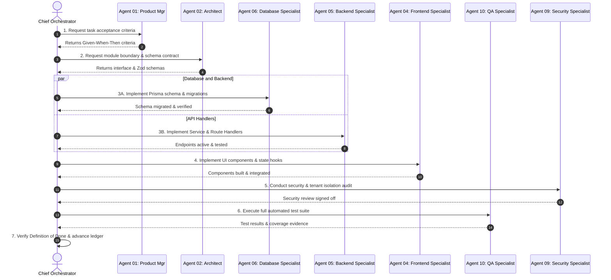

# Agent Coordination Protocol & Handoff Specifications

## Document Ref: `docs/ENGINEERING_SYSTEM/AGENT_COORDINATION_PROTOCOL.md`
**Project:** AI-Powered Google Business Profile Review Assistant & QR Management Platform  
**System:** Antigravity AI Engineering Operating System  
**Status:** ACTIVE & BINDING  

---

### 1. Sequential & Parallel Workflow Orchestration

To eliminate race conditions, merge conflicts, and architectural drift, work is handed off between specialized agents according to strict dependency protocols.



---

### 2. Standard Handoff Artifact Contract

Whenever an agent completes a slice of work and passes it to the next agent, it must produce a structured handoff note containing:

```markdown
### AGENT HANDOFF NOTICE
- **From Agent:** [e.g. Agent 06: Database Specialist]
- **To Agent:** [e.g. Agent 05: Backend & API Specialist]
- **Task ID:** [e.g. TASK-03-01: Prisma Schema Migration]
- **Modified / Created Files:**
  - `prisma/schema.prisma`
  - `prisma/migrations/20261112_init/migration.sql`
- **Interfaces / Contracts Provided:**
  - `export type BusinessWithConfig = Prisma.BusinessGetPayload<{ include: { aiConfig: true } }>`
- **Quality Gate Evidence:**
  - `prisma validate` -> Succeeded
  - `prisma db seed` -> Seeded 1 admin user, 1 demo business
- **Known Constraints / Next Steps:**
  - Backend service must query `Business` using composite index `(userId, status)`.
```

---

### 3. Conflict Resolution & File Ownership Rules

1. **Prisma Schema Ownership:** Exclusively owned by **Agent 06 (Database Specialist)**. No frontend or backend agent may edit `prisma/schema.prisma` directly.
2. **AI Provider Interfaces:** Exclusively owned by **Agent 07 (AI/LLM Specialist)**.
3. **Public Landing Page Route (`/app/r/[slug]`):** Exclusively owned by **Agent 04 (Frontend Specialist)** under the architectural guidance of **Agent 12 (Performance)** and **Agent 03 (UI/UX)**.
4. **Independent Peer Review Requirement:** High-risk changes (authentication logic, rate limiting, and URL redirection handlers) must be independently reviewed by **Agent 09 (Security)** before being marked complete.

