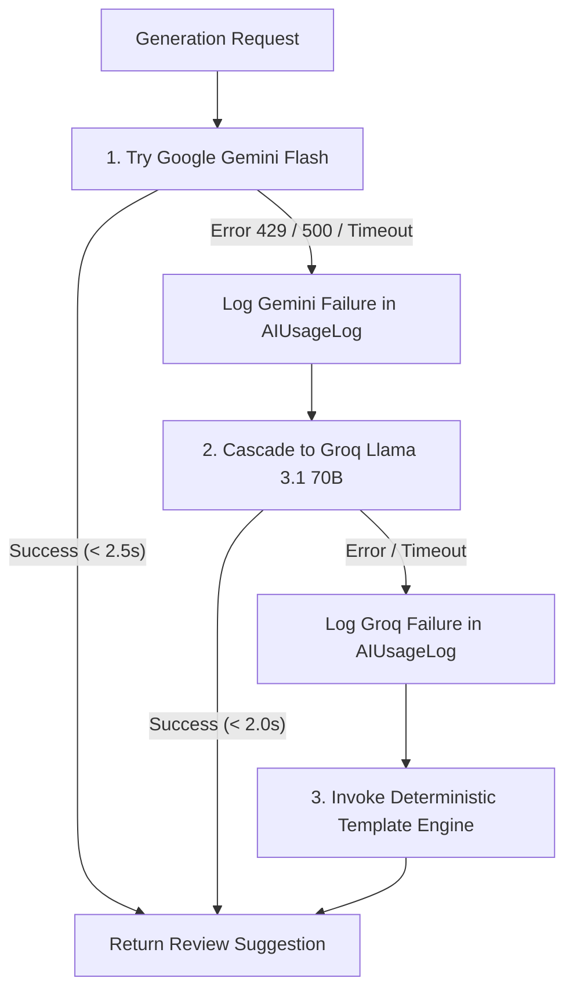

# Error-Handling, Recovery & Resilience Standard

## Document Ref: `docs/ENGINEERING_SYSTEM/ERROR_HANDLING_STANDARD.md`
**Project:** AI-Powered Google Business Profile Review Assistant & QR Management Platform  
**System:** Antigravity AI Engineering Operating System  
**Status:** ACTIVE & BINDING  

---

### 1. Error Categorization & Handling Strategy

The system categorizes all runtime failures into distinct domains with defined logging, user feedback, retry policies, and recovery actions.

```
+-----------------------------------------------------------------------------------+
|                        ERROR TAXONOMY & RESOLUTION MATRIX                         |
+-----------------------------------------------------------------------------------+
| Error Category        | HTTP  | User Experience           | Retry & Recovery Protocol     |
+-----------------------+-------+---------------------------+-------------------------------+
| Validation Error      | 422   | Inline field error message| No retry. Correct form input. |
| Authentication Error  | 401   | Redirect to /admin/login  | Refresh token / re-enter pwd. |
| Authorization Error   | 403   | "Access Denied" toast     | No retry. Log security audit. |
| Resource Not Found    | 404   | Clean empty / 404 screen  | No retry. Verify slug or ID.  |
| Database Conflict     | 409   | "Name already taken"      | Append unique suffix.         |
| Database Downtime     | 500   | Friendly error toast      | Exponential backoff (max 3).  |
| Primary AI 429/Timeout| N/A   | Transparent to user       | Immediate cascade to Groq.    |
| All AI APIs Down      | N/A   | Transparent to user       | Instant deterministic template|
| Mobile Clipboard Block| N/A   | Slide-up manual copy sheet| Fallback to long-press copy.  |
| Rate Limit Exceeded   | 429   | "Too many scans, wait 1m" | Block IP for 60 seconds.      |
+-----------------------------------------------------------------------------------+
```

---

### 2. Frontend Error & Resilience Patterns

1. **React Error Boundaries:** Top-level (`app/global-error.tsx`) and route-level (`app/(admin)/error.tsx`, `app/r/[slug]/error.tsx`) boundaries catch unhandled rendering exceptions, preventing white-screen freezes.
2. **Accessible Toast System:** Action errors (e.g., failed save) display an accessible toast notification with the error description and a direct `[Retry]` action.
3. **Graceful Mobile Degraded States:**
   - If business has paused campaigns: Render polite branded paused notice with a direct link to Google Maps.
   - If QR slug is invalid: Render a clean 404 card asking the patron to speak with venue staff.
   - If mobile browser denies clipboard write: Instantly display the manual copy sheet modal with pre-highlighted text.

---

### 3. Backend Error Mapping Architecture

Route Handlers catch exceptions via a centralized error handler:

```typescript
// lib/error-handler.ts
export function handleApiError(error: unknown, req: Request): Response {
  const requestId = req.headers.get("x-request-id") || generateRequestId();

  // 1. Zod Schema Validation Failure
  if (error instanceof ZodError) {
    return NextResponse.json(
      {
        success: false,
        error: {
          code: "VALIDATION_FAILED",
          message: "Request validation failed.",
          details: error.flatten().fieldErrors,
          requestId
        }
      },
      { status: 422 }
    );
  }

  // 2. Custom Application Domain Exception
  if (error instanceof AppError) {
    return NextResponse.json(
      {
        success: false,
        error: {
          code: error.code,
          message: error.message,
          details: error.details ?? null,
          requestId
        }
      },
      { status: error.statusCode }
    );
  }

  // 3. Prisma Known Request Error
  if (error instanceof Prisma.PrismaClientKnownRequestError) {
    if (error.code === "P2002") {
      return NextResponse.json(
        {
          success: false,
          error: {
            code: "SLUG_CONFLICT",
            message: "A business with this URL slug already exists.",
            details: null,
            requestId
          }
        },
        { status: 409 }
      );
    }
  }

  // 4. Unhandled Internal Server Exception (Sanitize details)
  logger.error({ err: error, requestId }, "Unhandled internal error");
  return NextResponse.json(
    {
      success: false,
      error: {
        code: "INTERNAL_ERROR",
        message: "An unexpected error occurred. Please try again later.",
        details: null,
        requestId
      }
    },
    { status: 500 }
  );
}
```

---

### 4. AI Provider Failover & Circuit Breaker Logic



1. **Timeout Guards:** Gemini requests are aborted via `AbortController` after **2,500ms**; Groq requests are aborted after **2,000ms**.
2. **Circuit Breaker:** If Gemini fails 5 consecutive times within 2 minutes, the orchestrator opens the circuit and routes all traffic directly to Groq for 10 minutes before testing Gemini again.
3. **Zero Infinite Loops:** Retries are bounded to a maximum of 1 attempt per provider before cascading.

