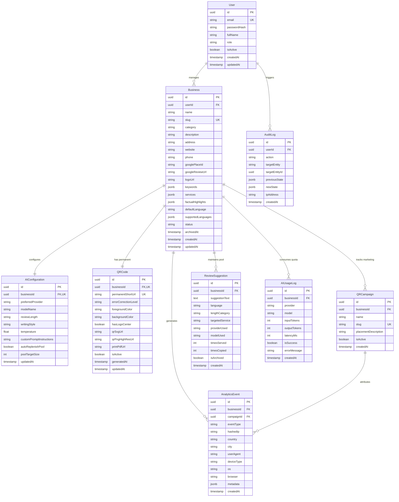

# Document 3: Complete Database Architecture & Schema Specification

## Project: AI-Powered Google Business Profile Review Assistant & QR Management Platform

---

### 1. Database Architectural Principles & Standards

The database is built on **PostgreSQL 16**, managed through **Prisma ORM**, adhering to the following strict relational principles:
1. **Multi-Tenancy via Agency Scoping:** All client businesses, QR codes, and configurations belong to an administrative tenant structure.
2. **Surrogate UUID Primary Keys:** All tables utilize RFC 4122 UUID v4 primary keys to prevent enumeration attacks and ensure seamless distributed replication.
3. **Structured Normalization with Targeted JSONB Denormalization:** Core relationships (User -> Business -> QRCode -> ReviewSuggestion) are strictly relational with foreign keys and referential integrity. Unstructured/semi-structured fields (such as variable keywords, service tags, and raw analytics user-agent payloads) leverage PostgreSQL `JSONB` with GIN indexing for maximum query performance without schema lockups.
4. **Soft Deletion & Audit Trail:** Business records and QR configurations utilize an `archivedAt` timestamp rather than hard physical deletion by default, preventing catastrophic data loss and preserving historical analytics attribution.
5. **Zero Customer PII Storage:** The system never records end-user names, email addresses, phone numbers, or device fingerprints. IP addresses are anonymized via one-way SHA-256 hashing or truncated to Class C (`xxx.xxx.xxx.0`) before storage to maintain GDPR/CCPA compliance.

---

### 2. Entity Relationship Diagram (ERD)

---

### 3. Detailed Data Dictionary & Schema Specification

#### 3.1 `User` Table (Authentication & Access Control)
Stores administrative staff and digital marketing agency account managers.
- `id` (`UUID`, Primary Key, default `gen_random_uuid()`): Unique identifier.
- `email` (`VARCHAR(255)`, Unique, Not Null): Login email address.
- `passwordHash` (`VARCHAR(255)`, Not Null): Argon2id or bcrypt hashed credentials.
- `fullName` (`VARCHAR(150)`, Not Null): Staff member name.
- `role` (`VARCHAR(50)`, Not Null, default `'AGENCY_ADMIN'`): Enums: `SUPER_ADMIN`, `AGENCY_ADMIN`, `STAFF_VIEWER`.
- `isActive` (`BOOLEAN`, Not Null, default `true`): Account active flag.
- `createdAt` (`TIMESTAMPTZ`, default `now()`): Creation timestamp.
- `updatedAt` (`TIMESTAMPTZ`, default `now()`): Last update timestamp.

#### 3.2 `Business` Table (Core Multi-Tenant Unit)
Represents a client establishment managed by the agency.
- `id` (`UUID`, Primary Key, default `gen_random_uuid()`): Unique identifier.
- `userId` (`UUID`, Foreign Key -> `User.id`, CASCADE on delete): Owning agency user.
- `name` (`VARCHAR(200)`, Not Null): Trading name of the business.
- `slug` (`VARCHAR(100)`, Unique, Not Null): Public routing slug used in URLs (e.g. `apex-dental`). Indexed.
- `category` (`VARCHAR(100)`, Not Null): Commercial category (e.g., "Cosmetic Dentistry").
- `description` (`TEXT`, Nullable): Overview for AI context.
- `address` (`VARCHAR(300)`, Nullable): Physical venue location.
- `website` (`VARCHAR(255)`, Nullable): Web homepage.
- `phone` (`VARCHAR(50)`, Nullable): Contact phone.
- `googlePlaceId` (`VARCHAR(150)`, Nullable): Google Maps Place ID. Indexed.
- `googleReviewUrl` (`TEXT`, Not Null): Destination URL where reviews are written.
- `logoUrl` (`TEXT`, Nullable): S3/R2 CDN link to business logo image.
- `keywords` (`JSONB`, Not Null, default `'[]'`): Array of SEO search terms to sprinkle in reviews.
- `services` (`JSONB`, Not Null, default `'[]'`): Array of specific service names provided.
- `factualHighlights` (`JSONB`, Not Null, default `'[]'`): Verifiable factual assertions to guide AI generation.
- `defaultLanguage` (`VARCHAR(20)`, Not Null, default `'en'`): Default review output language.
- `supportedLanguages` (`JSONB`, Not Null, default `'["en"]'`): Array of supported language codes.
- `status` (`VARCHAR(30)`, Not Null, default `'ACTIVE'`): Enums: `ACTIVE`, `INACTIVE`, `ARCHIVED`. Indexed.
- `archivedAt` (`TIMESTAMPTZ`, Nullable): Timestamp when business was soft-deleted.
- `createdAt` (`TIMESTAMPTZ`, default `now()`).
- `updatedAt` (`TIMESTAMPTZ`, default `now()`).

#### 3.3 `AIConfiguration` Table (Generation Tuning per Business)
Customizes generation parameters for each specific client business.
- `id` (`UUID`, Primary Key, default `gen_random_uuid()`).
- `businessId` (`UUID`, Foreign Key -> `Business.id`, Unique, CASCADE): 1-to-1 with Business.
- `preferredProvider` (`VARCHAR(50)`, Not Null, default `'GEMINI'`): Enums: `GEMINI`, `GROQ`, `CLOUDFLARE`, `DETERMINISTIC`.
- `modelName` (`VARCHAR(100)`, Not Null, default `'gemini-2.0-flash'`): Specific model identifier.
- `reviewLength` (`VARCHAR(30)`, Not Null, default `'MEDIUM'`): Enums: `SHORT`, `MEDIUM`, `LONG`.
- `writingStyle` (`VARCHAR(50)`, Not Null, default `'NATURAL'`): Enums: `NATURAL`, `PROFESSIONAL`, `ENTHUSIASTIC`, `SIMPLE`.
- `temperature` (`DECIMAL(3,2)`, Not Null, default `0.70`): Creativity parameter (0.0 to 1.0).
- `customPromptInstructions` (`TEXT`, Nullable): Agency custom instructions (e.g., "Mention our free parking lot").
- `autoReplenishPool` (`BOOLEAN`, Not Null, default `true`): Flag to maintain pre-generated pool.
- `poolTargetSize` (`INTEGER`, Not Null, default `10`): Number of active suggestions to maintain in pool.
- `updatedAt` (`TIMESTAMPTZ`, default `now()`).

#### 3.4 `QRCode` Table (Permanent QR Assets & Styling)
Stores vector assets and aesthetic configuration for the business's physical QR collateral.
- `id` (`UUID`, Primary Key, default `gen_random_uuid()`).
- `businessId` (`UUID`, Foreign Key -> `Business.id`, Unique, CASCADE): 1-to-1 with Business.
- `permanentShortUrl` (`VARCHAR(255)`, Unique, Not Null): Encoded URL (`https://reviews.domain.com/r/:slug`).
- `errorCorrectionLevel` (`VARCHAR(5)`, Not Null, default `'M'`): Enums: `L`, `M`, `Q`, `H`.
- `foregroundColor` (`VARCHAR(20)`, Not Null, default `'#000000'`): Hex color for QR modules.
- `backgroundColor` (`VARCHAR(20)`, Not Null, default `'#FFFFFF'`): Hex color for background.
- `hasLogoCenter` (`BOOLEAN`, Not Null, default `false`): Whether logo is embedded in center.
- `qrSvgUrl` (`TEXT`, Nullable): S3 URL to vector SVG asset.
- `qrPngHighResUrl` (`TEXT`, Nullable): S3 URL to 2048x2048 PNG asset.
- `printPdfUrl` (`TEXT`, Nullable): S3 URL to ready-to-print Table Tent PDF.
- `isActive` (`BOOLEAN`, Not Null, default `true`): Instant killswitch for QR redirection.
- `generatedAt` (`TIMESTAMPTZ`, default `now()`).
- `updatedAt` (`TIMESTAMPTZ`, default `now()`).

#### 3.5 `ReviewSuggestion` Table (Hybrid Pre-Generated Pool)
Stores high-quality pre-generated review drafts to guarantee sub-50ms landing page responses.
- `id` (`UUID`, Primary Key, default `gen_random_uuid()`).
- `businessId` (`UUID`, Foreign Key -> `Business.id`, CASCADE): Indexed.
- `suggestionText` (`TEXT`, Not Null): Draft review body ready for customer clipboard.
- `language` (`VARCHAR(20)`, Not Null, default `'en'`).
- `lengthCategory` (`VARCHAR(30)`, Not Null): `SHORT`, `MEDIUM`, or `LONG`.
- `targetedService` (`VARCHAR(150)`, Nullable): Service highlighted in this specific draft.
- `providerUsed` (`VARCHAR(50)`, Not Null): AI provider that generated this row.
- `modelUsed` (`VARCHAR(100)`, Not Null): Model name.
- `timesServed` (`INTEGER`, Not Null, default `0`): Impression count.
- `timesCopied` (`INTEGER`, Not Null, default `0`): Conversion count.
- `isArchived` (`BOOLEAN`, Not Null, default `false`): Rotation flag.
- `createdAt` (`TIMESTAMPTZ`, default `now()`).

#### 3.6 `AnalyticsEvent` Table (High-Throughput Telemetry)
Immutable event log tracking customer conversion funnel interactions.
- `id` (`UUID`, Primary Key, default `gen_random_uuid()`).
- `businessId` (`UUID`, Foreign Key -> `Business.id`, CASCADE): Indexed.
- `campaignId` (`UUID`, Foreign Key -> `QRCampaign.id`, Nullable, SET NULL): Optional campaign tag.
- `eventType` (`VARCHAR(50)`, Not Null): Enums: `QR_SCAN`, `LANDING_PAGE_VIEW`, `SUGGESTION_COPIED`, `GOOGLE_REDIRECT_CLICK`, `SUGGESTION_REFRESHED`. Indexed.
- `hashedIp` (`VARCHAR(64)`, Nullable): SHA-256 hashed IP for anonymous unique visitor counting.
- `country` (`VARCHAR(50)`, Nullable): Geo-IP resolved country code.
- `city` (`VARCHAR(100)`, Nullable): Geo-IP resolved city.
- `userAgent` (`TEXT`, Nullable): Raw browser user-agent string.
- `deviceType` (`VARCHAR(30)`, Nullable): `MOBILE`, `TABLET`, `DESKTOP`.
- `os` (`VARCHAR(50)`, Nullable): `iOS`, `Android`, `macOS`, `Windows`.
- `browser` (`VARCHAR(50)`, Nullable): `Mobile Safari`, `Chrome Mobile`, `Samsung Internet`.
- `metadata` (`JSONB`, Nullable): Supplementary telemetry (e.g. clipboard method, latency).
- `createdAt` (`TIMESTAMPTZ`, default `now()`): Indexed for time-series aggregation.

#### 3.7 `AIUsageLog` Table (Cost & Quota Observability)
Monitors API consumption, token usage, latency, and provider errors.
- `id` (`UUID`, Primary Key, default `gen_random_uuid()`).
- `businessId` (`UUID`, Foreign Key -> `Business.id`, CASCADE).
- `provider` (`VARCHAR(50)`, Not Null): `GEMINI`, `GROQ`, etc.
- `model` (`VARCHAR(100)`, Not Null).
- `inputTokens` (`INTEGER`, Not Null, default `0`).
- `outputTokens` (`INTEGER`, Not Null, default `0`).
- `latencyMs` (`INTEGER`, Not Null): Generation duration in milliseconds.
- `isSuccess` (`BOOLEAN`, Not Null): Boolean flag.
- `errorMessage` (`TEXT`, Nullable): Upstream error payload if failed.
- `createdAt` (`TIMESTAMPTZ`, default `now()`).

---

### 4. Indexing Strategy & Query Optimization

| Table | Index Columns | Type | Purpose |
| :--- | :--- | :--- | :--- |
| `Business` | `slug` | B-Tree (UNIQUE) | Sub-millisecond lookup on every public QR scan (`SELECT * FROM Business WHERE slug = :slug`). |
| `Business` | `userId`, `status` | Composite B-Tree | Fast filtering of active client lists in the agency admin dashboard. |
| `Business` | `keywords` | GIN Index | Fast search across business keyword arrays. |
| `ReviewSuggestion`| `businessId`, `isArchived`, `language` | Composite B-Tree | Instant selection of an active draft suggestion from the pool on customer landing page load. |
| `AnalyticsEvent` | `businessId`, `createdAt`, `eventType` | Composite B-Tree | High-speed range aggregation for dashboard charts (last 7 days, 30 days, 12 months). |
| `AnalyticsEvent` | `createdAt` | BRIN Index | Highly efficient time-series index for historical pruning and retention queries. |

---

### 5. Data Retention, Archival & Pruning Policies

1. **Analytics Events Retention:** Raw `AnalyticsEvent` records are retained in full fidelity for **180 days**. An automated daily cron job aggregates events older than 180 days into an `AnalyticsDailyRollup` summary table (`date, businessId, totalScans, totalViews, totalCopies, totalRedirects`) and purges the individual raw event rows, maintaining predictable database storage footprints.
2. **AI Usage Logs Retention:** Kept for **90 days** for debugging and billing reconciliation, then pruned automatically.
3. **Soft-Deleted Businesses:** Businesses flagged as `ARCHIVED` retain all configurations and historical aggregated metrics indefinitely unless the agency explicitly executes an audited "Hard Permanent Delete", which triggers cascading deletes across all child tables.

