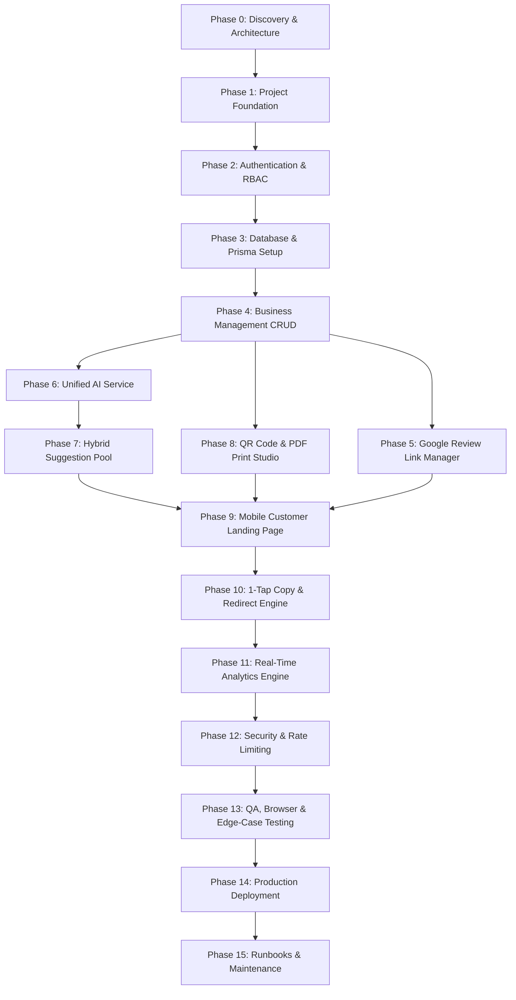

# Document 10: Phase-by-Phase Implementation Roadmap & Engineering Schedule

## Project: AI-Powered Google Business Profile Review Assistant & QR Management Platform

---

### 1. Implementation Sequencing Philosophy

The implementation roadmap is engineered with strict dependency hierarchy to eliminate rework, circular dependencies, and blocked workflows. Development progresses logically through four strategic milestones:

1. **Milestone I: Foundation & Core Data (Phases 0–3):** Establishes the technical baseline, database schema, multi-tenant security boundary, and authentication.
2. **Milestone II: Business Management & Intelligence Engines (Phases 4–7):** Builds the administrative catalog, Google link verification, multi-provider AI engine with fallback cascading, and the hybrid suggestion pool.
3. **Milestone III: Visual Delivery & Mobile Micro-Funnel (Phases 8–11):** Implements dynamic vector QR generation, PDF print collateral generation, the ultra-fast public mobile landing page, and the cross-device copy/redirect mechanics.
4. **Milestone IV: Hardening, Verification & Production Launch (Phases 12–15):** Enforces rate limiting, security headers, end-to-end browser QA, automated CI/CD deployment, and operational monitoring runbooks.

---

### 2. Comprehensive Phase-by-Phase Technical Specifications

---

#### Phase 0: Product Requirements, Compliance & Technical Architecture
- **Objective:** Finalize product boundaries, legal review policies, AI provider selection, and system architecture.
- **Why Necessary:** Prevents costly architectural rework, illegal review-gating implementation, or API rate limit bottlenecks during active coding.
- **Prerequisites:** Stakeholder alignment on product vision.
- **Exact Development Tasks:** Author 12 master planning deliverables covering functional requirements, schema design, UI blueprints, security, testing, and deployment.
- **Expected Files:** `docs/*.md` (12 documents).
- **Database / API Changes:** None.
- **Dependencies:** None.
- **Risks:** Scope creep toward building an unneeded CRM/ERP. *Mitigation:* Explicitly bound product to review generation and QR delivery.
- **Testing Instructions:** Peer review documentation against Master Prompt requirements.
- **Acceptance Criteria:** All 12 documents complete, mathematically consistent, and approved.
- **Completion Condition:** Zero source code changes; all technical decisions documented.
- **Rollback Plan:** N/A (Planning phase).

---

#### Phase 1: Project Foundation & System Scaffolding
- **Objective:** Initialize clean Next.js 15+ App Router TypeScript environment with Tailwind CSS and UI primitives.
- **Why Necessary:** Provides the baseline component system, design tokens, and environment configs for all subsequent modules.
- **Prerequisites:** Phase 0 approved.
- **Exact Development Tasks:** Initialize Next.js project; install Tailwind CSS, `shadcn/ui`, `zod`, `lucide-react`; configure `tsconfig.json`, `.eslintrc`, Prettier; create layout skeletons and error boundaries.
- **Expected Files:** `package.json`, `tsconfig.json`, `tailwind.config.ts`, `app/layout.tsx`, `app/globals.css`, `app/error.tsx`, `lib/utils.ts`.
- **Database / API Changes:** None.
- **Dependencies:** Node.js 20+, npm/pnpm.
- **Risks:** Incompatible dependency versions with Next.js 15. *Mitigation:* Pin verified stable releases.
- **Testing Instructions:** Run `npm run dev` and `npm run build` to verify clean builds with zero hydration errors.
- **Acceptance Criteria:** Local development server runs on `http://localhost:3000` with clean UI layout.
- **Rollback Plan:** Reset repository to initial commit.

---

#### Phase 2: Authentication, Access Control & Agency Multi-Tenancy
- **Objective:** Secure administrative routes with NextAuth.js (Auth.js v5) and enforce agency-level multi-tenancy.
- **Why Necessary:** Prevents unauthorized access to business records and API key vaults.
- **Prerequisites:** Phase 1 complete.
- **Exact Development Tasks:** Configure NextAuth with Credentials provider; implement Argon2id password hashing; build `/admin/login` page; create middleware route protection guard.
- **Expected Files:** `auth.ts`, `auth.config.ts`, `middleware.ts`, `app/(admin)/login/page.tsx`, `components/auth/login-form.tsx`.
- **Database / API Changes:** API route `POST /api/auth/[...nextauth]`.
- **Dependencies:** `next-auth@beta`, `argon2` or `bcryptjs`.
- **Risks:** Session leakage or infinite redirect loops in middleware. *Mitigation:* Write automated unit tests for middleware matcher patterns.
- **Testing Instructions:** Verify authenticated access to `/admin/dashboard`; verify unauthenticated requests redirect to `/admin/login`.
- **Acceptance Criteria:** Only authenticated agency users can access `/admin/*`. Public routes remain open.
- **Rollback Plan:** Disable middleware guard temporarily in staging.

---

#### Phase 3: Database Architecture, Models & Prisma ORM Setup
- **Objective:** Deploy PostgreSQL schema, execute Prisma migrations, and seed initial demo data.
- **Why Necessary:** Establishes the relational data model for businesses, AI configs, QR assets, and analytics.
- **Prerequisites:** Phase 2 complete; PostgreSQL instance provisioned.
- **Exact Development Tasks:** Define models in `schema.prisma` (`User`, `Business`, `AIConfiguration`, `QRCode`, `ReviewSuggestion`, `AnalyticsEvent`, `AIUsageLog`, `AuditLog`); configure indexes; run migration; write seed script.
- **Expected Files:** `prisma/schema.prisma`, `prisma/migrations/*`, `prisma/seed.ts`, `lib/prisma.ts`.
- **Database Changes:** Creation of 8 relational tables with foreign keys and unique constraints.
- **Dependencies:** `@prisma/client`, `prisma`.
- **Risks:** Database connection exhaustion on serverless edge. *Mitigation:* Instantiate singleton Prisma client with connection pooling.
- **Testing Instructions:** Run `npx prisma migrate dev` and `npx prisma db seed`; inspect tables via Prisma Studio.
- **Acceptance Criteria:** All tables created with correct foreign keys, indexes, and zero migration errors.
- **Rollback Plan:** `npx prisma migrate reset` (development only).

---

#### Phase 4: Business Management Module (Core CRUD)
- **Objective:** Provide agency users with a streamlined interface to create, edit, archive, and manage client businesses.
- **Why Necessary:** Represents the core operational entity of the platform.
- **Prerequisites:** Phase 3 complete.
- **Exact Development Tasks:** Implement Zod schemas; build `BusinessService`; create CRUD API routes (`/api/admin/businesses`); build Business Catalog table and Create/Edit drawers.
- **Expected Files:** `app/(admin)/businesses/page.tsx`, `components/business/*.tsx`, `services/business.service.ts`, `app/api/admin/businesses/route.ts`.
- **Database Changes:** Read/write operations on `Business`, `AIConfiguration`, `QRCode`.
- **API Changes:** `GET, POST /api/admin/businesses`, `GET, PATCH, DELETE /api/admin/businesses/[id]`, `POST /api/admin/businesses/[id]/archive`.
- **Dependencies:** React Hook Form, `@hookform/resolvers/zod`.
- **Risks:** Duplicate slugs leading to URL collisions. *Mitigation:* Enforce unique constraint and automated collision resolution.
- **Testing Instructions:** Create 5 businesses; edit keywords; archive 1 business; restore it; verify search filtering.
- **Acceptance Criteria:** Full CRUD operational with responsive validation, empty states, and error handling.
- **Rollback Plan:** Revert git commit and drop affected API routes.

---

#### Phase 5: Google Business Profile URL & Place ID Management
- **Objective:** Enable accurate input, verification, and testing of client Google review links.
- **Why Necessary:** A broken or malformed review link invalidates the entire customer journey.
- **Prerequisites:** Phase 4 complete.
- **Exact Development Tasks:** Build URL parser utility; create link verification API endpoint; add "Test Link" button in admin UI that opens review modal in new tab.
- **Expected Files:** `lib/utils/google-url.ts`, `app/api/admin/businesses/[id]/verify-google-url/route.ts`, `components/business/google-url-checker.tsx`.
- **Database Changes:** Stores verified URL and optional `googlePlaceId` on `Business`.
- **Dependencies:** None.
- **Risks:** Businesses submitting standard Google Search links instead of direct review dialog URLs. *Mitigation:* Provide visual helper guide in UI and automated URL structure validation.
- **Testing Instructions:** Test with 10 different Google review URL formats (desktop, mobile, short links).
- **Acceptance Criteria:** Only validated Google review links can be saved; live test button confirms working modal.
- **Rollback Plan:** Revert validation regex to lenient URL check if valid edge-case links are blocked.

---

#### Phase 6: Unified AI Service & Provider Failover Cascade
- **Objective:** Implement resilient AI generation service supporting Google Gemini Flash, Groq Llama 3.1 70B, and deterministic fallback.
- **Why Necessary:** Protects against external AI provider outages, rate limits, and latency spikes.
- **Prerequisites:** Phase 4 complete; API keys acquired.
- **Exact Development Tasks:** Create `IAIService` interface; implement Gemini and Groq adapters; build prompt builder with XML armor; implement failover orchestrator with error logging.
- **Expected Files:** `services/ai/ai-provider.interface.ts`, `services/ai/providers/*.ts`, `services/ai/ai-orchestrator.service.ts`, `services/ai/prompt-builder.ts`.
- **Database Changes:** Inserts into `AIUsageLog`.
- **Dependencies:** `@google/genai`, `groq-sdk`.
- **Risks:** Primary provider rate limits (HTTP 429). *Mitigation:* Instant automatic failover to Groq with zero user interruption.
- **Testing Instructions:** Simulate Gemini failure; confirm orchestrator catches error and serves Groq output in < 400ms.
- **Acceptance Criteria:** 100% successful generation return across test cases, even with external APIs disconnected.
- **Rollback Plan:** Route all requests to deterministic template provider.

---

#### Phase 7: Hybrid Review Suggestion Pool Architecture
- **Objective:** Maintain a pre-generated cache of 10 diverse review suggestions per business to eliminate landing page latency.
- **Why Necessary:** Cuts live AI costs by 90% and reduces customer landing page load time to < 50ms.
- **Prerequisites:** Phase 6 complete.
- **Exact Development Tasks:** Implement `SuggestionPoolService`; create pool replenishment worker; build admin suggestion preview drawer.
- **Expected Files:** `services/suggestion-pool.service.ts`, `app/api/admin/businesses/[id]/suggestions/route.ts`, `components/business/suggestion-pool-viewer.tsx`.
- **Database Changes:** CRUD on `ReviewSuggestion` table.
- **Dependencies:** None.
- **Risks:** Stale suggestions repeating across multiple customers. *Mitigation:* Track `timesServed` and schedule pool refreshment every 48 hours.
- **Testing Instructions:** Onboard business; verify 10 diverse suggestions are generated and stored; test retrieval latency.
- **Acceptance Criteria:** Pool query completes in < 30ms; suggestions cover diverse business services.
- **Rollback Plan:** Fall back to on-demand generation if pool table is empty.

---

#### Phase 8: Dynamic QR Code Generation & PDF Print Studio
- **Objective:** Generate vector SVGs, high-res PNGs, and print-ready PDF marketing collateral (Table Tents).
- **Why Necessary:** Physical QR codes are the bridge connecting in-store patrons to the digital platform.
- **Prerequisites:** Phase 4 complete.
- **Exact Development Tasks:** Build QR matrix engine using `qrcode`; implement PNG rasterizer with `sharp`; create PDF generator using `@react-pdf/renderer`; build QR Studio UI.
- **Expected Files:** `services/qr/*.ts`, `app/(admin)/qr-studio/page.tsx`, `components/qr/*.tsx`.
- **Database Changes:** Updates to `QRCode` record URLs.
- **Dependencies:** `qrcode`, `sharp`, `@react-pdf/renderer`.
- **Risks:** Large PDF rendering causing memory spikes. *Mitigation:* Stream PDF buffers directly without writing temporary files to disk.
- **Testing Instructions:** Download SVG, PNG, and PDF; print PDF; scan with physical phone to verify immediate redirection.
- **Acceptance Criteria:** QR code scans reliably from 3 feet away; PDF layout includes fold lines and verified branding.
- **Rollback Plan:** Serve standard monochrome QR code without custom framing.

---

#### Phase 9: Mobile Customer Landing Page (`/r/:businessSlug`)
- **Objective:** Deliver an ultra-fast, minimalist, mobile-first web page when customers scan a QR code.
- **Why Necessary:** This is the primary customer-facing screen of the product.
- **Prerequisites:** Phase 5, 7, 8 complete.
- **Exact Development Tasks:** Build public route `app/r/[slug]/page.tsx` as React Server Component; implement responsive card layout; embed business logo, suggestion text, and compliance disclaimer.
- **Expected Files:** `app/r/[slug]/page.tsx`, `components/public/customer-card.tsx`, `components/public/suggestion-rotator.tsx`.
- **Database Changes:** Fast read from `Business` and `ReviewSuggestion`.
- **Dependencies:** None (Pure CSS & HTML).
- **Risks:** Slow loading on 3G/4G connections. *Mitigation:* Inline critical CSS, zero external fonts, total payload < 35 KB.
- **Testing Instructions:** Load page via Chrome DevTools throttled to Fast 3G; measure TTI and LCP.
- **Acceptance Criteria:** TTI < 1.0 second; CLS = 0.00; layout adapts cleanly across iPhone SE, iPhone 15, and Android.
- **Rollback Plan:** Revert to minimal static HTML template.

---

#### Phase 10: Robust Single-Tap Copy & Google Redirect Workflow
- **Objective:** Ensure single tap on "Copy Review & Open Google" reliably copies text and opens Google Maps across all mobile browsers.
- **Why Necessary:** Eliminates typing friction while respecting mobile browser sandbox constraints.
- **Prerequisites:** Phase 9 complete.
- **Exact Development Tasks:** Implement universal copy handler (`navigator.clipboard` + `execCommand` fallback); implement 350ms tactile feedback delay; navigate via `window.location.href`; build manual copy fallback modal.
- **Expected Files:** `components/public/action-button.tsx`, `components/public/fallback-copy-modal.tsx`.
- **Database Changes:** None.
- **Dependencies:** None.
- **Risks:** Safari popup blocker blocking redirection. *Mitigation:* Use `window.location.href` instead of `window.open`.
- **Testing Instructions:** Test on physical iPhone Safari and Android Chrome; confirm review text is in clipboard upon landing on Google.
- **Acceptance Criteria:** 1-tap copies text and opens Google review dialog with zero popup warnings.
- **Rollback Plan:** Present manual copy modal by default.

---

#### Phase 11: Real-Time Analytics & Telemetry Engine
- **Objective:** Track QR scans, page views, suggestion copies, and Google redirects with privacy-safe IP hashing.
- **Why Necessary:** Proves ROI and conversion metrics to agency clients.
- **Prerequisites:** Phase 9, 10 complete.
- **Exact Development Tasks:** Implement beacon endpoint (`/api/analytics/track`); build User-Agent and Geo-IP parser; build admin Analytics charts and funnel visualization.
- **Expected Files:** `app/api/analytics/track/route.ts`, `services/analytics.service.ts`, `app/(admin)/analytics/page.tsx`, `components/analytics/*.tsx`.
- **Database Changes:** High-speed inserts into `AnalyticsEvent`.
- **Dependencies:** `ua-parser-js`, `recharts`.
- **Risks:** Analytics write flood degrading database performance. *Mitigation:* Buffer writes or use unlogged table with daily rollups.
- **Testing Instructions:** Trigger 10 scans and 5 copy events; verify dashboard metrics increment accurately.
- **Acceptance Criteria:** Funnel metrics display accurate step-down rates; no raw PII stored.
- **Rollback Plan:** Temporarily disable tracking beacon endpoint if database load spikes.

---

#### Phase 12: Security Hardening, Rate Limiting & Compliance Audit
- **Objective:** Protect public and admin endpoints against abuse, DDoS, prompt injection, and open redirects.
- **Why Necessary:** Ensures production reliability and prevents unexpected API billing spikes.
- **Prerequisites:** All functional phases complete.
- **Exact Development Tasks:** Implement Upstash Redis rate limiting; configure strict CSP and security headers; sanitize image uploads; audit tenant isolation.
- **Expected Files:** `lib/rate-limit.ts`, `next.config.js`, `app/api/admin/upload-logo/route.ts`.
- **Database Changes:** None.
- **Dependencies:** `@upstash/redis` or `@upstash/ratelimit`, `dompurify`.
- **Risks:** Overly restrictive CSP blocking legitimate assets. *Mitigation:* Test CSP rules in `Report-Only` mode before enforcing.
- **Testing Instructions:** Run automated rate limit attack script; verify HTTP 429 triggers at limit.
- **Acceptance Criteria:** Zero security vulnerabilities on automated OWASP scans; rate limiting active.
- **Rollback Plan:** Relax rate limit thresholds via environment variables.

---

#### Phase 13: End-to-End Testing, Browser Matrix & QA Verification
- **Objective:** Execute full testing matrix across mobile browsers, security penetrations, and edge cases.
- **Why Necessary:** Guarantees production-ready stability before client deployment.
- **Prerequisites:** Phase 12 complete.
- **Exact Development Tasks:** Write and execute Vitest unit tests, Playwright E2E browser tests, and Lighthouse mobile audits.
- **Expected Files:** `tests/**/*.test.ts`, `playwright.config.ts`.
- **Database Changes:** Test database provisioning.
- **Dependencies:** `vitest`, `@playwright/test`.
- **Risks:** Flaky E2E tests in CI/CD pipeline. *Mitigation:* Implement retry mechanisms and deterministic mock fixtures.
- **Testing Instructions:** Run `npm run test` and `npx playwright test`.
- **Acceptance Criteria:** 100% test pass rate across functional, security, and mobile test suites.
- **Rollback Plan:** Address identified bugs before proceeding to Phase 14.

---

#### Phase 14: Production Deployment & Infrastructure Orchestration
- **Objective:** Deploy production application, high-availability database, R2 asset storage, and custom domains.
- **Why Necessary:** Transition from local staging to a secure, public-facing production environment.
- **Prerequisites:** Phase 13 QA sign-off.
- **Exact Development Tasks:** Provision production PostgreSQL; run Prisma migrations; configure Cloudflare R2 bucket; deploy Next.js app to Vercel/Railway; configure custom SSL domains (`app.domain.com`, `reviews.domain.com`).
- **Database Changes:** Production schema migration.
- **Dependencies:** Cloudflare, Vercel/Railway, Neon/AWS RDS.
- **Risks:** DNS propagation delays. *Mitigation:* Pre-configure DNS records with low TTL 24 hours in advance.
- **Testing Instructions:** Perform live end-to-end smoke test from a physical mobile phone scanning a live production QR code.
- **Acceptance Criteria:** Production URL responds in < 300ms; SSL valid; live scan successfully copies review and opens Google.
- **Rollback Plan:** Instant roll-back to previous deployment build in hosting dashboard.

---

#### Phase 15: Operational Documentation, Monitoring & Maintenance Runbooks
- **Objective:** Establish telemetry alerts, automated database backups, and operational documentation.
- **Why Necessary:** Ensures long-term maintainability and rapid incident resolution for the engineering team.
- **Prerequisites:** Phase 14 complete.
- **Exact Development Tasks:** Set up Sentry error monitoring; configure uptime pingers; configure daily encrypted PostgreSQL backups; author client onboarding manual and maintenance runbook.
- **Expected Files:** `docs/AGENCY_USER_MANUAL.md`, `docs/MAINTENANCE_RUNBOOK.md`.
- **Database Changes:** Scheduled backup cron job.
- **Dependencies:** Sentry, BetterStack / UptimeRobot.
- **Risks:** Unnoticed API quota exhaustion. *Mitigation:* Automated Slack/Discord webhook alerts trigger at 80% quota threshold.
- **Testing Instructions:** Trigger test exception; verify Sentry alert arrives in Slack within 30 seconds.
- **Acceptance Criteria:** Monitoring active; backups running; documentation complete and verified.
- **Rollback Plan:** N/A (Documentation & Monitoring).

