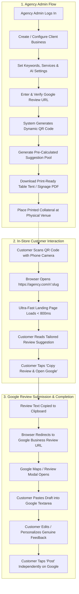

# Document 5: Complete System Workflow Mapping & Sequence Diagrams

## Project: AI-Powered Google Business Profile Review Assistant & QR Management Platform

---

### 1. High-Level End-to-End System Flow



---

### 2. Comprehensive 23-Workflow Detailed Specifications

Below is the exhaustive architectural specification for all 23 system workflows, detailing Trigger, Input, Processing, Database Operations, API Calls, Output, Possible Failures, and Recovery Behaviors.

---

#### Workflow 1: Admin Registration & Authentication
- **Trigger:** Agency staff visits `/admin/login` or accepts an agency invite.
- **Input:** Email address, password, optional MFA code.
- **Processing:** Validates email format; retrieves user record; verifies password against Argon2id hash; generates signed JWT / NextAuth session cookie (`HttpOnly`, `SameSite=Lax`, `Secure`).
- **Database Operations:** `SELECT * FROM "User" WHERE email = :email LIMIT 1;` Update `lastLoginAt`.
- **API Calls:** `POST /api/auth/callback/credentials`
- **Output:** Redirect to `/admin/dashboard` with active authenticated session.
- **Possible Failures:** Invalid credentials, account locked or inactive, database connection timeout.
- **Recovery Behavior:** Display user-friendly error toast; rate-limit subsequent attempts (5 failed attempts locks IP for 15 minutes).

---

#### Workflow 2: Add a Client Business
- **Trigger:** Admin clicks `[+ Add Business]` in `/admin/businesses`.
- **Input:** Business Name, Category, Physical Address, Website, Phone.
- **Processing:** Sanitizes inputs; converts Business Name to unique URL slug (`apex-dental-studio`); checks uniqueness against DB; initializes empty AI config and default QR record.
- **Database Operations:**
  ```sql
  BEGIN;
  INSERT INTO "Business" (id, userId, name, slug, category, address, website, phone, status)
  VALUES (gen_random_uuid(), :userId, :name, :slug, :category, :address, :website, :phone, 'ACTIVE')
  RETURNING id;
  INSERT INTO "AIConfiguration" (id, businessId, preferredProvider, reviewLength, writingStyle)
  VALUES (gen_random_uuid(), :businessId, 'GEMINI', 'MEDIUM', 'NATURAL');
  INSERT INTO "QRCode" (id, businessId, permanentShortUrl, errorCorrectionLevel)
  VALUES (gen_random_uuid(), :businessId, CONCAT('https://domain/r/', :slug), 'M');
  COMMIT;
  ```
- **API Calls:** `POST /api/admin/businesses`
- **Output:** Business record created; UI redirects to Step 2: Details & AI Configuration.
- **Possible Failures:** Slug collision (duplicate name), validation failure.
- **Recovery Behavior:** Automatically append randomized alphanumeric suffix to slug (`apex-dental-2`) and prompt admin.

---

#### Workflow 3: Configure Business Details, Keywords & Services
- **Trigger:** Admin completes initial business creation or opens Edit drawer.
- **Input:** JSON array of keywords (`["emergency dental", "gentle cleaning"]`), services (`["Teeth Whitening", "Invisalign"]`), factual highlights (`["Free parking in rear"]`), supported languages.
- **Processing:** Cleans and normalizes string tags; strips HTML/special characters; validates array lengths (max 25 keywords, max 15 services).
- **Database Operations:** `UPDATE "Business" SET keywords = :keywords, services = :services, factualHighlights = :facts, supportedLanguages = :languages, updatedAt = now() WHERE id = :id;`
- **API Calls:** `PUT /api/admin/businesses/:id/details`
- **Output:** HTTP 200 with updated business entity; triggers background suggestion pool generation.
- **Possible Failures:** Validation error; database lock.
- **Recovery Behavior:** Display inline validation error on individual tag inputs.

---

#### Workflow 4: Configure AI Review Generation Settings
- **Trigger:** Admin updates AI Tuning tab in Business settings.
- **Input:** Review Length (`SHORT`, `MEDIUM`, `LONG`), Writing Style (`NATURAL`, `PROFESSIONAL`, `ENTHUSIASTIC`, `SIMPLE`), Custom Prompt Instructions, Temperature (0.0 to 1.0).
- **Processing:** Validates parameters against allowed enum values; calculates updated prompt system template.
- **Database Operations:** `UPDATE "AIConfiguration" SET reviewLength = :length, writingStyle = :style, customPromptInstructions = :instructions, temperature = :temp, updatedAt = now() WHERE businessId = :businessId;`
- **API Calls:** `PUT /api/admin/businesses/:id/ai-config`
- **Output:** Updated configuration; automatically archives obsolete suggestion pool items and schedules pool regeneration.
- **Possible Failures:** Invalid parameter bounds.
- **Recovery Behavior:** Toast notification with validation guidance; revert to previous known-good config.

---

#### Workflow 5: Save & Verify Google Review URL
- **Trigger:** Admin pastes Google Review URL or searches for Google Place ID.
- **Input:** Target URL (e.g. `https://g.page/r/.../review` or `https://search.google.com/local/writereview?placeid=...`).
- **Processing:** Server validates URL format (must be valid HTTPS URL matching Google domains); extracts `placeid` parameter if present; runs an automated HEAD/GET check to verify non-404 response.
- **Database Operations:** `UPDATE "Business" SET googleReviewUrl = :url, googlePlaceId = :placeId WHERE id = :id;`
- **API Calls:** `POST /api/admin/businesses/:id/verify-google-url`
- **Output:** Green "Verified Google Link" badge in admin UI; unlocks QR download capabilities.
- **Possible Failures:** Invalid URL, non-Google domain, unreachable link.
- **Recovery Behavior:** Red error banner: *"The link provided does not appear to be a valid Google review dialog. Please verify the URL using Google's 'Get more reviews' button."*

---

#### Workflow 6: Generate Dynamic QR Code Assets
- **Trigger:** New business created or QR styling altered in QR Studio.
- **Input:** QR Foreground color, background color, center logo toggle.
- **Processing:** Node.js `qrcode` library computes matrix for `https://[domain]/r/[slug]`; `sharp` embeds logo in center with white border padding; generates vector SVG and 2048x2048 PNG buffer; uploads buffers to S3/R2 storage.
- **Database Operations:** `UPDATE "QRCode" SET qrSvgUrl = :svgUrl, qrPngHighResUrl = :pngUrl, foregroundColor = :fg, backgroundColor = :bg, hasLogoCenter = :logoCenter, generatedAt = now() WHERE businessId = :businessId;`
- **API Calls:** `POST /api/admin/businesses/:id/generate-qr`
- **Output:** Cloudflare R2 / S3 permanent public URLs for SVG and PNG assets.
- **Possible Failures:** Corrupted logo file, S3 upload timeout.
- **Recovery Behavior:** Fall back to generating clean standard QR code without center logo; log storage error.

---

#### Workflow 7: Download & Print Collateral (Table Tent PDF)
- **Trigger:** Admin clicks `[Download Print-Ready PDF]` in QR Studio.
- **Input:** Selected print template (Table Tent 4x6, Countertop 5x7, or Mini Sticker).
- **Processing:** Server-side `@react-pdf/renderer` constructs high-DPI vector PDF combining Business Logo, high-contrast QR code, verified instruction copy ("Scan with phone camera to review on Google"), and fold lines.
- **Database Operations:** `SELECT * FROM "Business" JOIN "QRCode" ON ... WHERE Business.id = :id;`
- **API Calls:** `GET /api/admin/businesses/:id/export-pdf?template=:template`
- **Output:** Binary PDF stream (`Content-Type: application/pdf; Content-Disposition: attachment; filename="Apex-Dental-Table-Tent.pdf"`).
- **Possible Failures:** Missing logo asset; rendering memory spike.
- **Recovery Behavior:** Render template with elegant stylized typography in place of missing logo; stream cached pre-rendered PDF if available.

---

#### Workflow 8: Customer Scans QR Code
- **Trigger:** End-consumer scans physical QR code in-store using iOS Camera or Android Google Lens.
- **Input:** HTTP GET request to `https://reviews.domain.com/r/apex-dental` with client headers (User-Agent, IP, Referer).
- **Processing:** Edge router parses slug; validates business status; resolves client geo-IP and device type; fires non-blocking asynchronous analytics beacon.
- **Database Operations:**
  ```sql
  -- Fast read on Edge
  SELECT id, name, slug, status, logoUrl, googleReviewUrl, defaultLanguage
  FROM "Business" WHERE slug = 'apex-dental' AND status = 'ACTIVE' LIMIT 1;
  -- Asynchronous insert (or via Redis queue)
  INSERT INTO "AnalyticsEvent" (businessId, eventType, hashedIp, userAgent, deviceType, country)
  VALUES (:businessId, 'QR_SCAN', :hashedIp, :ua, :device, :country);
  ```
- **API Calls:** Edge Route GET `/r/[slug]`
- **Output:** Server-rendered HTML payload delivered to customer mobile browser in < 250ms.
- **Possible Failures:** Business archived or inactive; slug does not exist.
- **Recovery Behavior:** Render branded polite fallback page: *"Apex Dental's review portal is currently paused. Tap here to visit our Google profile directly."*

---

#### Workflow 9: Customer Sees Tailored Review Suggestion
- **Trigger:** Mobile browser renders public landing page.
- **Input:** Business entity and pre-loaded review suggestion pool item.
- **Processing:** Server Component retrieves top active suggestion from the hybrid pool; renders suggestion text inside the prominent card container; prepares secondary suggestions in memory for instant cycling.
- **Database Operations:**
  ```sql
  SELECT id, suggestionText, targetedService FROM "ReviewSuggestion"
  WHERE businessId = :businessId AND isArchived = false
  ORDER BY timesServed ASC LIMIT 5;
  UPDATE "ReviewSuggestion" SET timesServed = timesServed + 1 WHERE id = :selectedId;
  ```
- **API Calls:** Embedded in initial SSR response (zero client-side secondary fetch required).
- **Output:** Rendered suggestion visible to user without layout shift.
- **Possible Failures:** Suggestion pool empty (e.g. AI quota failed earlier).
- **Recovery Behavior:** Deterministic template fallback engine dynamically constructs review text on the fly using business name and services: *"Visited Apex Dental for teeth cleaning. Friendly staff and great care. Highly recommend!"*

---

#### Workflow 10: Customer Copies Suggestion
- **Trigger:** Customer taps the primary CTA button **"Copy Review & Open Google"** (or taps manual copy icon).
- **Input:** Client-side touch event.
- **Processing:**
  1. Invokes `navigator.clipboard.writeText(suggestionText)`.
  2. If promise rejects, activates hidden `textarea` with `document.execCommand('copy')`.
  3. Updates button state to *"✓ Copied to clipboard! Opening Google..."*.
  4. Triggers device haptic vibration (`navigator.vibrate(50)`).
- **Database Operations:** Non-blocking beacon `POST /api/analytics/track` (`eventType: SUGGESTION_COPIED`).
- **API Calls:** Client Beacon API.
- **Output:** Review draft successfully stored in smartphone clipboard.
- **Possible Failures:** Mobile OS blocks programmatic clipboard writing due to strict browser security permissions.
- **Recovery Behavior:** Display fallback modal: pre-selects text inside box with prominent button: *"Tap and hold to copy, then tap Open Google."*

---

#### Workflow 11: Customer Redirected to Google Review Dialog
- **Trigger:** Success transition of Workflow 10 (350ms post-copy).
- **Input:** Target `googleReviewUrl`.
- **Processing:** Executes `window.location.href = targetGoogleUrl`. (Avoids `window.open` which triggers popup blockers on Safari).
- **Database Operations:** Non-blocking beacon `POST /api/analytics/track` (`eventType: GOOGLE_REDIRECT_CLICK`).
- **API Calls:** Client Beacon API.
- **Output:** Smartphone browser navigates to Google Maps / Google Business Profile review modal.
- **Possible Failures:** Corrupted Google link; user loses network connectivity.
- **Recovery Behavior:** If navigation fails within 2000ms, display permanent fallback link: *"Click here if Google didn't open automatically."*

---

#### Workflow 12: Customer Pastes & Edits Review in Google
- **Trigger:** Native Google review interface loads on user's phone.
- **Input:** User long-presses Google's text box and selects "Paste".
- **Processing:** External to application (User agency within Google ecosystem).
- **Database Operations:** None (Application respects user boundary).
- **API Calls:** None.
- **Output:** Review text appears in Google input box; customer adds, removes, or tweaks words to reflect genuine experience.
- **Possible Failures:** Customer forgets to paste; customer closes browser.
- **Recovery Behavior:** N/A (External user environment).

---

#### Workflow 13: Customer Independently Submits Review on Google
- **Trigger:** Customer selects star rating (e.g., 5 stars) and taps "Post" inside Google's UI.
- **Input:** Customer submission to Google servers.
- **Processing:** Handled entirely by Google's infrastructure.
- **Database Operations:** None.
- **API Calls:** None.
- **Output:** Review published on Google Maps / Google Search Business Profile.
- **Possible Failures:** Google spam filter flags review if multiple reviews originate from identical in-store IP in short duration.
- **Mitigation Architecture:** Suggestion pool diversity ensures distinct phrasing, avoiding duplicate review text flags.

---

#### Workflow 14: Analytics Event Recording & Processing
- **Trigger:** Public landing page beacon fired (`QR_SCAN`, `COPIED`, `REDIRECT`).
- **Input:** JSON payload: `{ businessSlug, eventType, timestamp, metadata }`.
- **Processing:** API route authenticates valid slug; hashes client IP using daily salt; parses User-Agent; inserts into `AnalyticsEvent` table.
- **Database Operations:** `INSERT INTO "AnalyticsEvent" (...) VALUES (...);`
- **API Calls:** `POST /api/analytics/track`
- **Output:** HTTP 204 No Content.
- **Possible Failures:** High traffic flood / DDOS.
- **Recovery Behavior:** Rate limit by IP using Redis token bucket (max 60 events/minute per IP); drop invalid slugs silently.

---

#### Workflow 15: Edit Business Details & Refresh Assets
- **Trigger:** Agency updates client details (new phone number, added service, updated keywords).
- **Input:** Modified fields in Admin edit drawer.
- **Processing:** Validates updates; saves changes; invalidates client edge cache for `/r/:slug`.
- **Database Operations:** `UPDATE "Business" SET ... WHERE id = :id;`
- **API Calls:** `PATCH /api/admin/businesses/:id`
- **Output:** Toast confirmation; instant reflection on public landing page.
- **Possible Failures:** Database timeout.
- **Recovery Behavior:** Retry transaction; notify user.

---

#### Workflow 16: Change Google Review URL
- **Trigger:** Business migrates to new Google listing or updates CID link.
- **Input:** New Google review URL.
- **Processing:** Validates new URL; verifies Google domain; updates database record. **Does NOT alter QR slug.**
- **Database Operations:** `UPDATE "Business" SET googleReviewUrl = :newUrl, updatedAt = now() WHERE id = :id;`
- **API Calls:** `PATCH /api/admin/businesses/:id/google-url`
- **Output:** Immediate redirection update. All previously printed physical QR codes immediately route to the new Google review link.
- **Possible Failures:** Invalid URL format.
- **Recovery Behavior:** Block save until URL passes syntax and domain validation.

---

#### Workflow 17: Change AI Provider or Model
- **Trigger:** Admin switches default provider from Gemini to Groq in Settings.
- **Input:** Provider selection (`GROQ`), Model (`llama-3.1-70b-versatile`).
- **Processing:** Tests API key connectivity and latency; updates global or per-business AI configuration.
- **Database Operations:** `UPDATE "AIConfiguration" SET preferredProvider = :provider, modelName = :model;`
- **API Calls:** `POST /api/admin/settings/ai-provider`
- **Output:** Subsequent background generation cycles use the new provider immediately.
- **Possible Failures:** Missing or invalid API key for target provider.
- **Recovery Behavior:** Prevent switch; test ping fails with detailed diagnostic message.

---

#### Workflow 18: Primary AI Provider Outage & Failover Cascade
- **Trigger:** Primary provider (Gemini) returns HTTP 429 (Rate Limit), 503 (Unavailable), or times out (> 2500ms).
- **Input:** Generation request for business review pool.
- **Processing:**
  1. Circuit breaker logs Gemini failure in `AIUsageLog`.
  2. Orchestrator immediately intercepts error and reroutes prompt payload to Secondary Provider (Groq Llama 3.1 70B).
  3. If Groq also fails, engine invokes Deterministic Template Engine.
- **Database Operations:**
  ```sql
  INSERT INTO "AIUsageLog" (businessId, provider, isSuccess, errorMessage, latencyMs)
  VALUES (:businessId, 'GEMINI', false, 'HTTP 429 Quota Exceeded', 2500);
  INSERT INTO "AIUsageLog" (businessId, provider, isSuccess, latencyMs)
  VALUES (:businessId, 'GROQ', true, 280);
  ```
- **API Calls:** Fallback API invocation.
- **Output:** Valid review suggestion returned with zero customer-facing interruption.
- **Possible Failures:** Complete network outage.
- **Recovery Behavior:** Deterministic template generator guarantees successful response.

---

#### Workflow 19: QR Code Deactivation (Killswitch)
- **Trigger:** Admin toggles QR code status to "Inactive" (e.g. client paused agency retainer).
- **Input:** QR toggle in admin business view.
- **Processing:** Sets `isActive = false` on `QRCode` and `status = 'INACTIVE'` on `Business`.
- **Database Operations:** `UPDATE "QRCode" SET isActive = false WHERE businessId = :id; UPDATE "Business" SET status = 'INACTIVE' WHERE id = :id;`
- **API Calls:** `POST /api/admin/businesses/:id/toggle-qr`
- **Output:** QR code disabled. In-store scans redirect to a polite paused notice.
- **Possible Failures:** Cache latency.
- **Recovery Behavior:** Edge cache revalidation header issued immediately (`revalidateTag('business-' + slug)`).

---

#### Workflow 20: Business Archiving (Soft-Delete)
- **Trigger:** Client contract terminates; admin clicks "Archive Business".
- **Input:** Admin confirmation modal.
- **Processing:** Sets `status = 'ARCHIVED'` and `archivedAt = now()`. Hides business from active dashboard views while preserving all historical scan logs and analytics.
- **Database Operations:** `UPDATE "Business" SET status = 'ARCHIVED', archivedAt = now() WHERE id = :id;`
- **API Calls:** `POST /api/admin/businesses/:id/archive`
- **Output:** Business removed from active catalog; moved to "Archived" filter tab.
- **Possible Failures:** Active database locks.
- **Recovery Behavior:** Standard transactional rollback.

---

#### Workflow 21: Business Restoration
- **Trigger:** Client re-hires agency; admin clicks "Restore Business".
- **Input:** Business ID in Archived tab.
- **Processing:** Sets `status = 'ACTIVE'` and clears `archivedAt`.
- **Database Operations:** `UPDATE "Business" SET status = 'ACTIVE', archivedAt = NULL WHERE id = :id;`
- **API Calls:** `POST /api/admin/businesses/:id/restore`
- **Output:** Business immediately restored. Existing physical QR codes resume active review routing without any re-printing.
- **Possible Failures:** Slug was claimed by another business during archival period.
- **Recovery Behavior:** Prompt admin to select a new unique slug before re-activation.

---

#### Workflow 22: Permanent Business Deletion (Hard Delete)
- **Trigger:** Admin initiates permanent destruction to comply with GDPR "Right to be Forgotten" or delete test data.
- **Input:** Admin must explicitly type the exact business name into a confirmation modal.
- **Processing:** Cascades deletion across all child records (`AIConfiguration`, `QRCode`, `ReviewSuggestion`, `AnalyticsEvent`, `AIUsageLog`); triggers S3 deletion of associated logo, QR PNG, and PDF files.
- **Database Operations:** `DELETE FROM "Business" WHERE id = :id;` (Cascading foreign keys purge child rows).
- **API Calls:** `DELETE /api/admin/businesses/:id`
- **Output:** Complete removal from database and cloud storage.
- **Possible Failures:** Name mismatch in confirmation modal; S3 deletion timeout.
- **Recovery Behavior:** Reject operation if confirmation name does not match; queue S3 orphan cleanup job.

---

#### Workflow 23: Automated System Backup & Disaster Recovery
- **Trigger:** Automated cron schedule (daily at 02:00 UTC) or pre-deployment hook.
- **Input:** PostgreSQL database dump command (`pg_dump`).
- **Processing:** Executes streaming encrypted database backup; uploads compressed snapshot to separate geographical storage bucket (e.g. AWS S3 Glacier in different region); verifies backup checksum and integrity; retains 30 rolling daily snapshots.
- **Database Operations:** Read-only replica snapshot extraction.
- **Output:** Signed backup artifact stored in disaster recovery vault; health report dispatched to admin webhook.
- **Possible Failures:** Storage quota exceeded; database network interruption.
- **Recovery Behavior:** Trigger high-priority alert to engineering team on Slack/Discord; auto-retry backup after 15 minutes.

